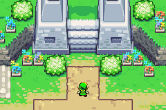

# Minish Studio user guide

[Project overview and quick start](README.md) · [Artwork credits](CREDITS.md)

An unofficial scene and animation editor for **The Legend of Zelda: The Minish Cap**. Build scenes with original game artwork, change character poses, arrange individual boss parts, create a carousel, or animate your composition. It works offline and can be hosted on GitHub Pages.

The original game logo sits at the top center. Game-derived lettering, stone frames, menu artwork, and dialogue borders give the tool its Minish Cap appearance. **SerakSan** is the creator credit. That software watermark is not burned into exported scenes.

For the downloaded app, extract the entire offline ZIP and open `index.html`. No account or server is needed. [START-HERE.txt](START-HERE.txt) has the short installation and local-save instructions.

## Animation workspace

Use the **Scene / Animate** switch between the Minish Studio title and game logo. Ezlo travels right to Animate and left to Scene using seven genuine cap poses. The travel and timing are made for the editor. Reduced-motion settings show the destination immediately. Animate has its own project, clips, Undo, and browser autosave.

### Simple: choose, place, play

New animation work starts in **Simple**. Choose an action for each piece and arrange the composition; no timeline editing is required. Your Simple / Timeline preference is remembered locally, and existing custom animation can stay in Timeline.

1. **Choose your artwork.** In Game art, choose a collection and character or source. Animations shows ready actions; Still poses lets you choose a specific game pose. Set Speed and Movement, then drag the card onto the canvas or choose Add to clip. Import current scene copies an existing composition into a new clip and preserves the scene project.
2. **Place each piece.** Drag it, enter X/Y, or use the one-pixel nudge controls. In Simple, moving a piece shifts its whole motion path, including when playback is paused partway through. Placement beyond the frame is supported; only the frame is exported.
3. **Choose its animation.** Select a placed piece and change Action, Speed, Movement, and Distance in Settings. Choose Apply animation. Movement includes four directions, floating up and down, and out and back. Still artwork can move too. Scale, flips, layers, order, and duplication remain available.
4. **Add a message.** Add dialogue, write the complete text, and choose Text reveal as its action. Speed controls the reveal. The full message stays editable while the preview shows each prefix. A short clip extends to fit the reveal and a reading pause, within the 600-frame limit.
5. **Play and save.** Set Length in seconds and playback style, then press Play or Space. Stop returns to the beginning. Save project keeps an editable `.minish-animation.json`; Export animation offers the formats below. Focus gives the canvas more room, and Show panels restores the tools.

There are **66 reviewed ready actions across 21 sources**, including Link, Zelda, animals, enemies, effects, and all nine boss families. The 38 boss assembly actions use 202 of the 206 supplied complete-boss poses. Transformation and materialization actions play through once and hold the final pose, extending a short clip when needed. The other four supplied poses remain available as still artwork, with movement or Timeline editing. These lists use specific genuine poses, with timing authored for the editor. Source rows are never treated as automatic animation sequences. A source without a reviewed action remains available as a still pose, with movement and precise placement. Use Timeline to build another action from the supplied art.

Simple and Timeline edit the same clip. Custom pose, movement, or dialogue keys are kept when switching modes. A piece with custom animation shows a notice: continue in Timeline, or explicitly choose **Replace this piece’s animation** to use a ready action. Replacement affects that piece's action and movement; its visibility and visual settings are retained. Undo restores the custom animation.

### Timeline: direct every change

Choose **Timeline** when you want exact timing, custom pose sequences, entrances, visibility changes, or separate boss components. Simple actions appear as editable keys here.

1. **Choose a piece and frame.** Select a track, canvas piece, or entry in Pieces. The interface counts frames from 1. Use the scrubber, frame field, or previous/next controls to move through time.
2. **Record changes.** With Record edits as keys enabled, dragging or changing X/Y, pose, scale, flips, layer, visibility, or dialogue records a key at the playhead. Turn it off to edit the base piece. Position moves between keys; poses and other settings hold until the next relevant key.
3. **Build a pose sequence.** In Game art, choose exact poses with the checkboxes or Shift-click, set Frames per pose, and choose Create pose sequence. Repeat and Back & forth control the cycle. Add Link walk cycle uses ten reviewed back-facing walking poses. A source group can mix actions, directions, and separate parts, so choose each pose deliberately.
4. **Add motion and dialogue.** Quick motion creates position keys that combine with pose changes. Move a background for a camera-style pan. Dialogue supports text, size, color, box dimensions, visibility, and a Unicode-aware typewriter reveal. To animate boss components independently, use Edit boss parts in Scene, then import that scene.
5. **Refine and preview.** Add, delete, copy, paste, or drag keys. Previous/next key controls jump between changes. Lock prevents edits, Mute hides a track, and Visible can be keyed. Previous frame is an editing overlay omitted from exports. Choose FPS, frame count, and Loop, Play once, or Back and forth.

Clips can be added, named, duplicated, and deleted independently of scene carousels. The walking demo includes a moving town scene and a transparent pose cycle.

Animation uses genuine supplied art and authored editor timing. Published sheets do not enumerate every ROM animation state or its exact timing. Multipart boss loops remain editor assemblies. The collection supports new compositions and animation authoring; it does not certify every scene, hidden layer, or animation from the game.

Animation limits are 30 clips, 1,000 pieces per clip, 1–600 frames, 1–60 FPS, and 16–1024 native pixels per side. Export enlargement is integer 1–8× within the displayed pixel and memory limits. Larger scene-maker compositions remain editable in Scene; create a smaller animation canvas when importing exceeds an animation limit.

### Export animation

| Format | Use | Pixel and timing behavior |
| --- | --- | --- |
| PNG frames ZIP | Exact frames, compositing, video workflows | Full RGBA pixels, frame timing, editable project, source references, and credits. |
| Sprite sheet ZIP | Reusable animated sprites or game pipelines | Lossless PNG sheets with frame coordinates and timing JSON; large sheets split into pages. |
| Animated GIF | A directly playable animation | Exact RGB when the combined palette fits; otherwise explicit color reduction. Transparency is binary and frame delays round to 10 ms. |
| MP4 or WebM video | Sharing a movie | Available when the browser supports recording. Compression changes pixels; transparency uses the scene background. Odd MP4 dimensions may add one background pixel. |

Exports show progress and can be cancelled. Video records in real time. GIF and PNG export remain available when the browser cannot record video. A pose cycle can remain transparent in PNG or GIF. Scene grids, selection boxes, previous-frame overlays, and the software watermark are excluded.



The editable [Walking Adventure example](examples/Walking%20Adventure.minish-animation.json) uses reviewed Link source poses. Its demo timing is authored for the editor. All media is rendered locally in the browser with no upload service.

## Make a scene

Open `index.html` or visit your hosted copy. Keep the folder together for offline use. A saved browser project takes priority when reopening.

1. **Choose a place.** Open Environments and choose a clean game region or recovered house tile. Place a region as your background, or use the tile views to build your own layout.
2. **Choose your cast.** Characters, Full bosses, Objects, Enemies, and Boss parts have separate windows. Pick a source, then a visual pose. Click to make it your brush, or double-click to place it.
3. **Paint or arrange.** Paint stamps the current brush. Select moves a placed piece. The visible mode instruction tells you which action is active. Settings has a scene piece list, so you can select objects hidden behind another image.
4. **Change a pose.** Select a placed actor, choose another pose from the same collection, and press Change selected pose. Position, flips, scale, and layer are preserved, with character feet anchored.
5. **Give the canvas room.** Focus hides the collection, inspector, and carousel. Show panels brings them back. Settings remains available while focused.
6. **Choose any shape.** Open Settings → Canvas & background for social presets and Free format. Enter native width, height, and PNG enlargement, then Apply size. Existing pieces keep their positions.
7. **Save or share.** Export PNG saves one scene. Export all PNGs saves a carousel ZIP and editable project JSON. Save project keeps a portable editable copy. Open restores it.

Add dialogue with the Dialogue button. Duplicate scenes to build a carousel. **Delete scene** beside the scene tabs removes the current scene in one action. Deleting the last scene creates a blank canvas in the same format. **Delete animation** does the same for the current animation clip. Undo restores the complete scene or clip, including all pieces and keys.

## Place pieces precisely

Drag a piece from the collection or its selected preview into the workspace. The drag cursor holds the middle of the piece. The scene preview shows its actual placement, including any grid snapping. For an exact centered drop, turn on **1 px precision** or hold **Alt on Windows / Option on Mac**. Odd-size pieces round to the nearest whole native pixel.

- Choose a tile to match its 8, 16, or 32 px grid automatically when snapping is enabled. Existing off-grid pieces retain their alignment when moved by grid steps.
- Watch the live **X/Y** readout. Use Settings to enter exact coordinates, including negative positions.
- Arrow keys and the four nudge buttons move the selected piece by one native pixel. Shift moves by the current grid step.
- Drag, select, or paint in the area around the frame. Off-frame artwork appears faintly and remains editable. Only the area inside the frame is exported; scene dimensions do not change.
- Each library drop or completed drag is one Undo action. Focus and zoom give small tiles more room.

## Random scenes and wild adventures

Press **Random scene**, choose a setting, and create a new scene. The generator adds it to the carousel without overwriting your current work. Game-inspired mode uses authored camera areas and reviewed placement zones; Wild mode makes imaginative arrangements.

In Game-inspired mode:

- Town and castle scenes use appropriate residents and remain peaceful.
- Woodland scenes use forest enemies and a genuine world chest, rather than scattering inventory menu icons on the ground.
- Minish Village uses village residents at the game's close-up scale.
- Boss encounters use a genuine Dark Hyrule Castle arena and compatible Vaati forms, rather than putting an arbitrary boss in a town square.

Repeat a scene exposes an optional seed. The same seed, setting, story mood, cast size, and generator/library versions reproduce the same starting composition. Generated scenes are new compositions made with game art, rather than claims to reconstruct a moment from a playthrough. Each placed item stays editable.

The generator offers **1,388 named setting and story combinations**: 200 Game-inspired adventures and 1,188 Wild mashups, drawn from 48 stories across 99 genuine game environments. Settings include outdoor places, houses, shops, royal rooms, Minish homes, dungeons, and unusual environments. Story mood and cast size give you control over the cast and arrangement.

**Game-inspired** uses reviewed floor areas and compatible casts. **Wild mashups** creates intentionally unlikely adventures using genuine game artwork: boss summits, Cucco bodyguards, royal field trips, monster parades, portal parties, and treasure rushes. These are imaginative editor assemblies; Wild placement does not claim to follow the game's collision ground or reconstruct gameplay. **Surprise me with either** mixes both styles.

Press **Surprise me again** beside Random scene to reroll in one click. It uses a fresh seed and the generated scene's last choices. The current generated scene changes in the same carousel slot, including any edits; one Undo restores the previous version. When a scene started from scratch is active, a new scene is added instead. The settings window still has Create random scene when you want an additional scene.

Repeat with the same seed, setting, story mood, cast size, adventure style, and generator/library versions to reproduce a composition.

## Windows and Mac controls

Open **Controls** beside the placement coordinates, or choose **More → Windows & Mac controls**. The guide compares both platforms and explains mouse, trackpad, collection, scene, export, and editing controls. Shortcut hints detect the platform automatically; choose Windows, Mac, or Show both in the guide to override the labels locally.

| Action | Windows | Mac |
| --- | --- | --- |
| Open / Save project | Ctrl+O / Ctrl+S | Command+O / Command+S |
| Undo | Ctrl+Z | Command+Z |
| Redo | Ctrl+Y or Ctrl+Shift+Z | Command+Shift+Z |
| Copy / cut / paste selected piece | Ctrl+C / Ctrl+X / Ctrl+V | Command+C / Command+X / Command+V |
| Duplicate selected piece | Ctrl+D | Command+D |
| Delete selected piece | Delete or Backspace | Delete (⌫); Fn+Delete also works |
| Delete current scene or animation | Ctrl+Shift+Delete or Backspace | Command+Shift+Delete (⌫) |
| Send back / bring forward | [ / ] | [ / ] |
| Send to back / bring to front | Shift+[ / Shift+] | Shift+[ / Shift+] |
| Zoom canvas / actual size / fit | + or − / 0 / F | + or − / 0 / F |
| Paint / Select / Erase / Dialogue | B / V / E / T | B / V / E / T |
| Nudge 1 px / one grid step | Arrows / Shift+Arrows | Arrows / Shift+Arrows |
| Bypass snapping while dragging | Alt | Option (⌥) |
| Deselect / close panels or dialogs | Esc | Esc |
| Guide | ? | ? |
| Focus controls / activate a button | Tab or Shift+Tab / Enter or Space | Tab or Shift+Tab / Enter or Space |
| Navigate collection tabs | Left/Right, Home/End | Left/Right, Home/End |

Use a primary mouse or trackpad click to choose controls. Drag collection pieces by their center, and scroll the workspace with the mouse wheel, scrollbars, or two fingers. Pinch with two fingers over the canvas to zoom around the pointer. Ctrl+mouse wheel is an alternative on Windows and Mac. Ordinary two-finger scrolling pans the workspace. Zoom also uses the −, +, actual-size, and Fit controls. Enlarged pixels settle at integer magnification. Mac Control-click and secondary clicks keep the browser context menu. On Mac, enable browser keyboard navigation if Tab skips controls.

Delete, Backspace, copy, cut, paste, and duplicate work from the placed-piece list as well as the canvas. Text fields keep native text editing, selection, arrow navigation, and Undo. Piece copying stays inside the editor and does not replace your system clipboard. Save and Open remain available. Scene shortcuts pause while a dialog is open, and composition and AltGr text entry never trigger scene commands. Tool buttons, X/Y fields, nudge buttons, and the precision toggle provide alternatives to shortcuts.

## Full bosses and their parts

The full-boss collection was rebuilt after checking gameplay captures, the published component sheets, and relevant transformation facts from the public Minish Cap decompilation. It includes anatomy missing from earlier editor arrangements: Chuchu neck/base parts, Octorok limbs and articulated tail, Gyorg eyes and tails, and Vaati's separate eyes and arms.

Use the boss state and direction filters to find the supplied variants. Select a placed multipart boss and press **Edit boss parts** to turn the assembled image into individually editable pieces at the same position, scale, and flips. Move or replace a component, or Undo to restore the complete boss.

An older saved project can still retain its original editor arrangement. Select that boss and use **Update older boss** to replace it with a corrected current pose while keeping its position and scale. Undo restores the older appearance.

[Boss animation coverage](assets/bosses/animation-coverage.json) records every ready action, source pose order, body anchor, and source checksum. [Boss reference review](assets/bosses/reference-review.html) shows the presets, component crops, and research links. Coverage notes describe the supported states and limitations. Some game poses use continuous affine scaling, rotation, or articulated movement. The downloaded sheets do not contain a complete game animation system. The ready variants are reference-informed assemblies, not a verified enumeration of every rendered pose in the ROM. Unsupported combinations stay available as individual parts; they are not advertised as confirmed complete poses.

## Clean game art and the source archive

Normal galleries use the curated library. Reviewed community headings, ripper captions, logos, palette ramps, comparison panels, example screenshots, and ambiguous edited variants are excluded from the ready choices. Kinstone headings and similar sheet labels are not scene objects.

Environment views use clean region crops and explicit tile masks. The supplied 16 px house tiles were recovered only where intact source cells could be identified, without the source sheet's inserted grid lines. No missing artwork is painted in and no background is invented. Source coordinates and verification records remain available.

The environment images preserve the genuine game pixels within their recorded source regions. A regular 8, 16, or 32 px crop is not a claim about the game's internal ROM tile IDs or boundaries. Reusing genuine tiles to design a new arrangement is supported; a custom arrangement is not an original game map.

**Source archive** is an advanced crop tool. Its original sheets can still contain community labels, credits, examples, and uncertain artwork. Those originals are retained unchanged for provenance and manual inspection. Select actual game art deliberately when using that archive. Raw source access is not a certification that every pixel on a contributed sheet originated in the game.

**PNG ↓** downloads the selected piece with its transparency. Credits contains a link to the clean game sprite PNG pack. That pack uses the curated selection. The old processing pack is not the ready game-asset library.

## Editing and export

- Terrain, Objects, and Overlay layers; precise X/Y; integer scale; flips; duplication; front/back ordering; and deletion.
- Editable game-style dialogue with a fallback for unsupported characters.
- Portrait, square, story, game-screen, and free canvas shapes.
- Custom native dimensions: 16–2048 px per side. PNG enlargement: 1–8×, up to 8192 px per side and 16,777,216 export pixels.
- PNG scenes, transparent piece PNGs, editable JSON, and carousel ZIPs, created entirely in the browser.
- Keyboard and mouse controls are listed for Windows and Mac in the Controls guide and the table above.
- Narrow screens use Pieces and Settings drawers. Advanced file/help/source actions stay available through More and Source archive.

## Credit, privacy, and publishing

All 134 original source downloads are preserved. Original game artwork is credited to Nintendo / Capcom. Every published sheet contributor and source page is listed in [CREDITS.md](CREDITS.md) and the searchable Credits window. The centered logo is derived from the USA Title Screen sheet, source 6558.

Minish Studio is an independent fan project. Its original editor code is MIT-licensed to **SerakSan**. Game graphics and source-derived UI retain separate rights. See [ASSET_RIGHTS.md](ASSET_RIGHTS.md).

There are no editor accounts, analytics, advertisements, or upload server. Projects and crop bookmarks stay in the browser until you download them. The public publishing kit excludes private backups, development environments, local paths, browser data, and personal scene exports. Hosting providers still process ordinary website requests. See [PRIVACY.md](PRIVACY.md).

No repository is created or published by opening this folder. Supported browsers can install the hosted HTTPS app for offline editing; the downloaded folder also works directly.

## Files and verification

- `assets/originals/`, `assets/sheets/`, and `assets/source-manifest.json`: immutable source downloads, normalized sheets, original links, and checksums.
- `assets/curated.js`, `.json`, and `assets/curated/`: trusted gallery choices, clean map regions, tile masks, exclusions, random scene templates, and the current foreground PNG pack.
- `assets/full-bosses.js`, `.json`, and `assets/bosses/`: current complete boss variants, transformed editable parts, exact source recipes, references, and verification.
- `assets/legacy-bosses.js`: historical editor images retained for saved-project compatibility, never offered as current gameplay poses.
- `assets/pieces.*` and `assets/sprites.*`: underlying extraction and transparency processing records. These base indices include historical source cuts; the curated index controls normal galleries.
- `assets/game-ui.js`, `assets/logo.*`, and `assets/ui/`: source-derived typography, frames, and the original game logo with credits.
- `random-scenes.js`: deterministic setting-aware composition.
- `simple-animation.js`: reviewed ready actions, whole-path placement, dialogue reveal, and custom-animation safeguards.
- `ezlo-switch.js`, `ezlo-switch.css`, and `assets/ui/ezlo-switch/`: genuine cap pose crops, source mapping, and the workspace switch.
- `tests/editor-smoke.mjs`: editing, component reconstruction, random placement, export, and compatibility checks.

The complete local working edition also retains the original raw grid-cut archives under `tiles/`. Those archives reconstruct the whole contributed sheets, including labels and backgrounds; they are archival processing outputs, not the trusted game tile collection. They are omitted from the GitHub publishing kit.

The source verification report covers all 134 sheets, 319,918 deduplicated raw tiles, and 902,696 source-grid cells. Curated-region and boss verification reports separately check source pixels and component reconstruction. Verification does not prove that an ambiguous contributed edit exists in the game; uncertain material is kept out of the trusted gallery.

The editable [Boss Showcase](examples/Boss%20Showcase.minish.json) is a ready-to-open example using the corrected arena and multipart boss.

The editor requires no installation. Node and Python run code checks and the public release builder. Image rebuilding uses Pillow and fonttools from `requirements.txt`.

```sh
node tests/editor-smoke.mjs
node tests/controls.mjs
node tests/random-scenes-variation.mjs
node tests/animation-engine.mjs
node tests/animation-ui-controls.mjs
node tests/simple-animation.mjs
node tests/animation-export.mjs
node tests/ezlo-switch.mjs
python3 tools/build_public_release.py --output release/minish-studio-github --archive release/Minish-Studio-GitHub.zip
```

For optional local preview, run `python3 tools/preview.py`, open `http://127.0.0.1:8765`, and stop the preview when finished. The image builders in `tools/` retain exact source mappings and do not change the originals.
