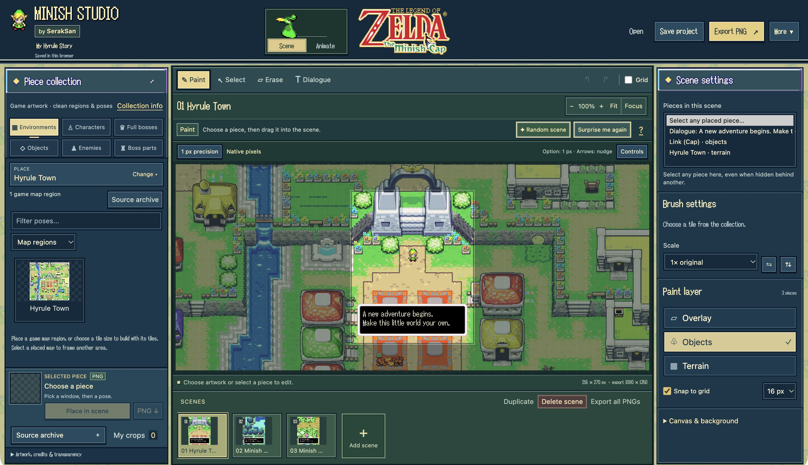

# Minish Studio

**A free scene maker and sprite animation editor for The Legend of Zelda: The Minish Cap, created by SerakSan.**

Build your own Zelda scenes with genuine game sprites and environment tiles. Arrange characters, objects, and multipart bosses, write dialogue, and bring the composition to life. Make a game-style moment, an Instagram post, a carousel, or an animated adventure, all in your browser.

**The included artwork is already bundled.** Extract the app, open it, and start creating. No account, ROM, asset import, or additional installation is needed. The downloaded app works offline.

**[Launch Minish Studio](https://seraksan.github.io/minish-studio/)** · [Download the offline ZIP](https://github.com/SerakSan/minish-studio/releases/latest/download/Minish-Studio-Offline.zip)



[Get started](#get-started) · [User guide](GUIDE.md) · [Credits](CREDITS.md)

## What you can make

| Tool | What it lets you do |
| --- | --- |
| Scene maker | Combine environments, characters, enemies, objects, poses, and dialogue in a layered composition. |
| Simple animation | Choose an action, place each piece, set its speed and movement, then press Play. No frame-by-frame editing is required. |
| Timeline animation | Direct custom pose sequences, movement, visibility, dialogue, and timing with editable keys. |
| Multipart bosses | Place a complete boss editor assembly or separate it into editable components. Choose from 206 assemblies and 176 parts across nine boss families. |
| Precise placement | Use native-pixel X/Y coordinates, snapping, one-pixel nudges, integer scaling, flips, layers, and off-frame placement. Pan and pinch to zoom into the canvas. |
| Social formats | Create square posts, portrait images, stories, game-screen compositions, and multi-scene carousels. Free format accepts custom dimensions. |
| Random scenes | Start from 1,388 named setting and story combinations, from game-inspired encounters to wild mashups. Reroll in one click, then edit every placed piece. |

The interface uses game-derived lettering, menu frames, and an Ezlo workspace switch. The **SerakSan** creator credit stays in the software and is excluded from exported scenes and animations.

## Get started

### Download and use offline

1. Download [**Minish-Studio-Offline.zip**](https://github.com/SerakSan/minish-studio/releases/latest/download/Minish-Studio-Offline.zip).
2. Extract the entire ZIP. On Windows, use **Extract All** before opening the app.
3. Open **index.html** in a current desktop browser. Keep the app files and `assets` folder together.
4. Choose **Scene** to compose an image, or **Animate** to create an animation.
5. Choose **Save project** to download an editable backup, and use Export when you want a finished image or animation.

No command line, build step, or local server is required to use the editor. Windows and macOS controls are shown in the app's **Controls** guide. Desktop mouse and trackpad use provide the most editing space.

### Launch in your browser

Open [Minish Studio](https://seraksan.github.io/minish-studio/) to start creating in your browser. The same included artwork loads with the app. Editing and exports happen on your device.

Supported browsers can install the hosted app in its own window. Load it once online before using the cached editor offline. The extracted offline ZIP is the most predictable way to keep every supplied file available without a connection. See the [installation instructions](START-HERE.txt).

## Your first scene

1. Choose a place from **Environments** and add it to the canvas.
2. Open **Characters**, **Objects**, **Enemies**, or **Full bosses**. Pick a pose and drag the piece into the scene.
3. Use **Select** to move a piece. Enter exact X/Y coordinates in Settings, or nudge with the arrow keys.
4. Add dialogue, adjust the layers, and choose a canvas format. Duplicate the scene to make the next carousel slide.
5. Choose **Export PNG** for one image or **Export all PNGs** for the carousel.

For a starting idea, choose **Random scene**, then **Surprise me again** to try another composition. Undo restores the previous version. [Placement, layers, and scene controls](GUIDE.md#make-a-scene) are covered in the user guide.

## Animate your scene

Use the **Scene / Animate** switch at the top of the editor. The animation workspace has its own projects, clips, Undo, and autosave. **Import current scene** copies your composition into an animation.

- **Simple** is the quickest way to begin. Choose a ready action for a piece, place it, and set its speed, movement, and distance. Text reveal animates dialogue without manually adding keys.
- **Timeline** gives you control over individual changes. Build pose sequences, key positions and visibility, adjust the timing, and preview the previous frame while editing.

There are **66 ready actions across 21 artwork sources**, including **38 boss assembly actions** across all nine boss families. Simple and Timeline edit the same clip, so you can start with a ready action and refine it later.


Open the editable [Walking Adventure animation](examples/Walking%20Adventure.minish-animation.json) with **Open** in Animate. You can also try the [Boss Showcase scene](examples/Boss%20Showcase.minish.json) or [My Hyrule Story carousel](examples/My%20Hyrule%20Story.minish.json) in Scene.

Ready actions use genuine supplied poses with timing authored for the editor. Multipart boss poses and loops are **editor assemblies**. They are not advertised as extracted game-engine animation frames. See the [animation guide](GUIDE.md#animation-workspace) and [boss coverage records](assets/bosses/animation-coverage.json) for details.

## Export and keep editing

| Format | Best for |
| --- | --- |
| PNG | A scene, transparent piece, or lossless still image. |
| Carousel ZIP | All scene images together with an editable project. |
| Animated GIF | A playable animation for sharing. GIF has palette and transparency limits. |
| PNG frames ZIP | Lossless RGBA animation frames, timing, and further compositing. |
| Sprite sheet ZIP | PNG animation sheets with frame coordinates and timing data. |
| MP4 / WebM | Video, when recording is supported by the browser. |
| Editable project JSON | Save a scene or animation and reopen it later. |

PNG exports preserve crisp pixels at integer enlargement. GIF may reduce colors when needed, and video uses compression. Grids, selection boxes, and editing overlays are excluded from finished exports. [Export details and limits](GUIDE.md#export-animation) explain the differences.

## Local projects and privacy

Minish Studio has no editor account, analytics, or project upload service. Scenes, animations, and exports are processed in your browser. A hosted copy still makes ordinary requests to its hosting provider to download the application.

Browser autosave belongs to the current browser and app location. **Use Save project for a portable backup**, especially before moving the app folder, changing browsers, or clearing browser data. A PNG or video is a finished export; keep the editable project file if you want to change the composition later.

Read [PRIVACY.md](PRIVACY.md) for storage and hosting details.

## Artwork, credits, and license

Created and maintained by **SerakSan**. Minish Studio is an independent, unofficial fan project and is not affiliated with or endorsed by Nintendo, Capcom, or The Spriters Resource.

The artwork collection comes from [The Spriters Resource's Minish Cap sheets](https://www.spriters-resource.com/game_boy_advance/thelegendofzeldatheminishcap/). It preserves 134 original source downloads with contributor credits, source URLs, and checksums. [CREDITS.md](CREDITS.md) lists the source contributors; the app also has searchable credits.

The curated galleries exclude reviewed sheet labels and community presentation material. The advanced **Source archive** retains contributed sheets for provenance and manual cropping, including their original annotations. The collection covers the supplied source manifest, rather than a verified extraction of every sprite, pose, map, or hidden layer in the game. Regular grid cuts do not establish the game's internal tile boundaries.

- **Original editor code:** [MIT license](LICENSE), credited to SerakSan.
- **Game artwork and source-derived material:** separate third-party rights. The MIT code license does not license these assets or grant permission to redistribute them. See [ASSET_RIGHTS.md](ASSET_RIGHTS.md).

## Help and contributions

Start with the in-app **Guide** and **Windows & Mac controls**, or read the [full user guide](GUIDE.md). For a bug or feature request, open an issue in this repository. Include your browser, operating system, steps to reproduce the problem, and what you expected to happen. Only attach project files or screenshots you are comfortable making public.

Code, usability improvements, documentation, and source-mapping corrections are welcome through pull requests. Keep the editor usable by opening `index.html` directly, preserve existing project compatibility, and use genuine artwork. Keep `assets/originals/` unchanged and retain contributor credits, source mappings, and checksums. Run the checks relevant to your changes. Asset-processing changes also require `tools/verify_assets.py` and inspection of its report.

## For developers and publishers

The runtime uses browser HTML, CSS, and JavaScript. The GitHub source edition includes the development tools and checks. Node and Python are only needed for checks and release preparation. Optional image rebuilding requires the packages listed in that edition's `requirements.txt`.

```sh
node tests/editor-smoke.mjs
node tests/controls.mjs
node tests/random-scenes-variation.mjs
node tests/animation-engine.mjs
node tests/animation-ui-controls.mjs
node tests/animation-export.mjs
node tests/simple-animation.mjs
node tests/ezlo-switch.mjs
python3 tools/build_public_release.py --output release/minish-studio-github --archive release/Minish-Studio-GitHub.zip
```

For optional local preview, run `python3 tools/preview.py` and open `http://127.0.0.1:8765`. Stop the preview when finished.

The GitHub source edition includes a GitHub Pages workflow and a release builder. Native Windows EXE and macOS DMG installers are not included in this release.

[Changelog](CHANGELOG.md) · [Asset structure and verification](GUIDE.md#files-and-verification) · [Artwork rights](ASSET_RIGHTS.md)
